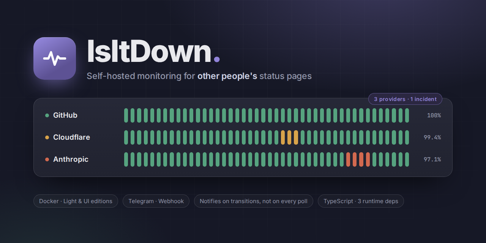

<p align="center">
  
</p>

[](https://github.com/DevManfre/isitdown/releases)
[](.github/workflows/ci.yml)
[](LICENSE)
[](.nvmrc)
[](tsconfig.json)
[](docs/development.md#92-tech-stack)

[](docs/development.md#92-tech-stack)
[](docs/docker.md#4-docker)
[](docs/theming.md#82-localisation)

**English** · [Italiano](README.it.md)

Self-hosted, containerized monitoring for **other people's** status pages. It polls
the public status pages of the providers you depend on — GitHub, Cloudflare,
Anthropic, npm, anything running Atlassian Statuspage — and messages you when one
of them changes state.

It exists so a single developer or a small team gets early warning about upstream
trouble without keeping five status dashboards open. It notifies on *transitions*,
never on every poll, so a quiet week is a silent week.

Two editions from one codebase: **Light** (polling and notifications only, no
server) and **UI** (the same engine plus a local dashboard, configured at runtime).

## Contents

On this page: [1. What it does](#1-what-it-does) · [2. Quick start](#2-quick-start) ·
[10. Terminal client](#10-terminal-client) · [11. Roadmap](#11-roadmap) · [12. Branch layout and merge policy](#12-branch-layout-and-merge-policy)

The manual, one file per section:

- [3. Configuration](docs/configuration.md) — `config.yml`, runtime settings, secrets, providers, channels, routing, delivery policy
- [4. Docker](docs/docker.md) — images, Compose profiles, volumes and probes, Kubernetes, outposts
- [5. Verifying a deployment](docs/verifying.md) — smoke checks, the dashboard, an end-to-end notification, troubleshooting
- [6. HTTP API](docs/api.md) — every route, the metrics, live updates, badges
- [7. How it works](docs/how-it-works.md) — data flow, components, when a notification fires, resilience, outpost consensus
- [8. Theming and localisation](docs/theming.md) — themes, the six dashboard languages, accessibility
- [9. Development](docs/development.md) — layout, tech stack, live development, tests, releases
- [10. Terminal client](docs/cli.md) — `isitdown watch`, a read-only fleet view for a terminal, `isitdown discover`, a first fleet read from a project's own files, and `isitdown import`, a fleet carried over from Uptime Kuma, Gatus, Statping or StatusGator

Each page has an Italian twin beside it (`docs/<name>.it.md`).

## 1. What it does

Every few minutes IsItDown fetches each provider's status page, normalises the
answer, compares it with what it saw last time, and sends a message only if
something actually changed.

```
GitHub          operational    ████████████████████████████  99.98%
Cloudflare      degraded       ███████████████▁▁▁▁▁████████  99.61%   ← you get a message
Anthropic       operational    ████████████████████████████  99.93%
```

### Core principles

- **No external dependencies at runtime.** No database server, no message broker,
  no cloud account. A JSON file or an embedded SQLite file is enough at this scale.
  The exceptions are opt-in: outposts ([Docker §4.7](docs/docker.md#47-outposts--a-second-point-of-view-for-probes))
  are containers you run yourself for a second reading of your probes, and
  incident summaries ([3.36](docs/configuration.md#336-incident-summaries--settings--ai-implementation))
  call a model you name. With neither configured, nothing reaches for one.
- **Config-driven.** Adding a provider never means touching code — an entry in
  `config.yml` (Light) or a dialog in the dashboard (UI).
- **Idempotent notifications.** Only state *transitions* notify: operational →
  degraded, degraded → outage, outage → resolved. A restart notifies nothing.
- **Provider-agnostic.** Most providers run Atlassian Statuspage and need no code
  at all; anything else gets a small adapter.
- **Secrets from the environment only.** A token is read from an environment
  variable, never written to a config file, a database, an API response or a log
  line. The UI edition can save one to a `0600` file beside its database, still
  as a variable, so the dashboard can set a credential without a restart.

### The two editions

|  | Light | UI |
|---|---|---|
| Image | `ghcr.io/devmanfre/isitdown:light-latest` | `…:ui-latest` (built `FROM` light) |
| Poller · Adapters · Diff Engine · Notifiers | shared | shared |
| Configuration | `config.yml`, re-read every cycle | SQLite, edited in the dashboard |
| State store | JSON file, atomic writes | SQLite (also carries history) |
| HTTP server | none | Express on :3000 |
| Uptime history and charts | — | 7/30/90-day views, plus a year heat calendar per provider |
| Theme | — | light / dark / system, plus high-contrast, colour-blind and OLED variants and a custom accent |
| Localisation | notification text | notification text **and** the whole dashboard, in six languages (`en`, `de`, `es`, `fr`, `it`, `pt`) |
| Footprint | 264MB image, no listening socket | 267MB — the Light image plus one layer |

Both editions run the same core engine. They differ only in what gets injected
into it: where configuration comes from, and where state is kept.

### The dashboard

The UI edition's dashboard is a React single-page app served from the same
process as the API, at `http://localhost:3000`. Its views, all reachable from the
rail, the command palette (`⌘K` / `Ctrl+K`) and the keyboard shortcuts:

| View | What it answers |
|---|---|
| **Overview** | Is anything down right now? A calm headline, the provider list, and a composable grid of widgets you can arrange and save as named dashboards. |
| **Providers** · **Components** | The fleet, one row per provider, and the same fleet seen component by component; each provider has its own page with uptime, a year heat calendar, latency, incidents, a map and its runbook. |
| **Incidents** | Every incident as a list under a Gantt timeline, each with its own page. |
| **History** | Uptime over 7, 30 or 90 days, in up to five tabs: trend, reliability, patterns, compare and latency. |
| **Delivery log** | What was sent, to which channel, and what it said or why it failed. |
| **Settings** | Providers, channels, routing, delivery policy, appearance and data, applied on the next cycle without a restart. |
| **Wallboard** | A full-screen, chrome-less view for a spare display, with a QR code to the provider in the worst trouble. |

It is light, dark or system, with high-contrast, colour-blind and OLED variants,
and translated into six languages. Every route behind it is documented in
[the HTTP API](docs/api.md); the walkthrough is in
[Verifying a deployment](docs/verifying.md).

---

## 2. Quick start

### 2.1 With Docker

**UI edition, without a clone** — one file, two commands. The images are
published to GHCR for `linux/amd64` and `linux/arm64`, so this is also the
Raspberry Pi, Unraid, Portainer and Synology path:

```bash
curl -O https://raw.githubusercontent.com/DevManfre/isitdown/main/docker-compose.yml
docker compose --profile ui up -d
# then visit http://localhost:3000
```

Everything the UI edition needs is configured in the dashboard, credentials
included: **Settings → a channel → Value → Save** applies at once. Put them in a
`.env` next to the compose file instead if you would rather the container own
them — it is optional, and read if present:

```bash
printf 'TELEGRAM_BOT_TOKEN=...\nTELEGRAM_CHAT_ID=...\n' > .env
docker compose --profile ui up -d      # recreates the container with the tokens
```

**Light edition** — polling and notifications, nothing listening. This one needs
a `config.yml` to mount, so start from a clone:

```bash
git clone https://github.com/DevManfre/isitdown.git && cd isitdown
cp .env.example .env                # only fill in the channels you will enable
cp config.example.yml config.yml    # edit: providers, interval, channels
docker compose --profile light up -d
docker logs -f isitdown-light
```

Both can run at once; they use separate data volumes.

Contributors building from the source tree add `--build`, which overrides the
pull and builds the image locally instead:

```bash
docker compose --profile ui up -d --build
```

### 2.2 Without Docker

Requires **Node 26** for the build as well as the runtime — `.nvmrc` pins it and
`npm install` refuses anything older, because the runtime's own SQLite driver and
native TypeScript support are load-bearing at build time too. `build:ui`
additionally runs Vite to bundle the dashboard; `build:light` skips that step,
since Light ships no dashboard.

```bash
nvm use                             # or: nvm install 24
npm install
cp config.example.yml config.yml
cp .env.example .env

npm run build:light && node dist/light/index.js     # Light
npm run build:ui    && node dist/ui/server.js       # UI, then open :3000
```

Useful overrides when running locally: `CONFIG_PATH`, `DATA_PATH`, `DB_PATH`,
`PORT`, `LOG_LEVEL` (see [3.3](docs/configuration.md#33-environment-variables)).

---

## 11. Roadmap

Delivered:

- **v1 — Light edition**: polling, the diff engine, Telegram and generic-webhook
  notifications, `config.yml` with environment-referenced secrets, a JSON state store
  with atomic writes, `ghcr.io/devmanfre/isitdown:light-latest`.
- **v1.1 — UI prototyping**: the dashboard explored in Claude Design and kept in
  `design/claude-design-prototypes/`. Option `3a`, the navigable console, is the
  implementation reference; the dark palette and the longer Italian label lengths were
  validated there rather than discovered later.
- **v1.2 — UI edition**: that design as an Express dashboard (first written as plain
  ES modules, since replaced by the React one below) over SQLite, with configuration managed at runtime and applied on the next cycle without
  a restart. `ghcr.io/devmanfre/isitdown:ui-latest`, built `FROM` the Light image.
- **v1.3 — history**: per-provider uptime and incident history with status-page daily
  bars and 7/30/90-day views, aggregated server-side and served from `/history`.
- **v1.4 — dark mode and i18n**: token-based light/dark/system theming with a
  persisted preference, and a localised dashboard (`en`, `it`) on top of the localised
  notification messages both editions already share.
- **v1.5 — the React dashboard**: the vanilla dashboard ported to React 19, Vite,
  Tailwind v4 and shadcn/ui, bundled into `dist/ui/public` and served by the same
  Express server; the client reads the server's aggregates through TanStack Query
  and never re-derives a percentage.

Since v1.5 (on `dev`): adapters for AWS, Google Cloud and Azure, conditional
requests so most cycles are a `304`, a per-provider poll cadence, the delivery log
view, a provider removal that can be undone inside a restore window, ntfy and
Gotify alongside the other channels, a year heat calendar per provider,
readiness split from liveness, an integrity check and vacuum on demand, and a
committed Grafana dashboard, then:

- **Notifications**: over thirty channels held to one contract — chat, push, on-call
  and incident tools, email, SMS and calls — with a delivery policy (shared-failure
  summary, update coalescing, a quiet period for known outages, a periodic report,
  an on-call rotation and a weekly routine delivery test).
- **Dashboard**: a composable Overview built from a widget catalogue, with named
  dashboards, a "while you were away" summary and numbers that link to their rows;
  an incident Gantt, latency percentiles, five-way compare, zoomable history,
  a Components view, a manual fleet order, a command palette with text search,
  keyboard shortcuts, filters kept in the address, a first-run wizard and guided
  tour, and an accessibility pass (axe) over every frame.
- **Wallboard and feeds**: a QR code that opens the provider in the worst trouble,
  a pulse and an optional sound when a tile changes, and the fleet served as a
  1-bit PNG and SVG for e-ink frames and chats.
- **Operator quality of life**: a Markdown runbook per provider, shown on its
  page and quoted in every alert; tags beside the group, filterable and routable
  as `tag:<name>`; planned mutes, weekly or one-off; maintenance windows the
  operator declares, silencing and drawn like a provider's own; bulk edit of
  cadence, group, tags, mute and polling across a selection; and Duplicate on
  any provider ([3.25–3.29](docs/configuration.md#325-runbooks--what-to-do-when-it-is-down)).
- **Calm redesign**: one job per view — an Overview that answers "is anything
  down?" and folds the rest away, one provider list instead of two, History split
  into five tabs, Settings listed by category, a one-line header, spacing and motion
  on design tokens, and the decorative effects retired. Nothing was deleted; the
  secondary features moved behind tabs, disclosures and menus.
- **Configuration safety net**: every configuration write recorded in a history you
  can restore a value from, named snapshots of the whole configuration, a diff
  preview before a `config.yml` import is applied, and a provider read from an
  unsaved form before it is saved ([6. HTTP API](docs/api.md#6-http-api)).
- **Analysis and reporting**: old days rolled up instead of deleted, year-on-year
  comparison, the cost of an outage, postmortem and SLA-credit exports, a printable
  monthly report, a 7-day incident forecast from the last 90 days' rate, a quarterly
  vendor report card graded per axis, the words and components that keep
  breaking ([3.32–3.35](docs/configuration.md#332-daily-rollups--what-retention-keeps)),
  and an opt-in plain-language summary of an incident's updates, written by the
  Anthropic API, an OpenAI-compatible server or your own Claude Code
  ([3.36](docs/configuration.md#336-incident-summaries--settings--ai-implementation)),
  and your own metric — from Prometheus or a CSV — drawn under the incident
  timeline ([3.37](docs/configuration.md#337-your-metric-under-the-incidents)).
- **Hardening**: the dashboard binds to loopback by default, refuses cross-origin
  and rebound-host writes, caps response bodies and refuses link-local targets.
- **Catalogue and tooling**: a provider catalogue of 205 entries, the `isitdown
  discover` and `isitdown import` commands, and CI split into parallel jobs.

Still open:

- A native review of the Italian strings.

The roadmap that carried the project this far is finished — every row of it
shipped.

**What IsItDown is.** Both an aggregator of status pages and a monitor of
things that publish none — and every provider says which of the two answers for
it. A status page provider is `declared`: its own page is the record, and a
probe that disagrees is reported as a disagreement rather than as an overrule. A
probe is `observed`: our reading is the record, and a page that contradicts it is
an opinion. The default comes from the adapter and needs no configuration; the
`authority` field is only there for the cases where the operator disagrees with
that default. This was left open for two roadmaps, and leaving it open is why
"what does 93% mean here" had two answers on one screen.

Explicit non-goals: multi-user auth (this is a local, single-operator dashboard),
status pages behind a login, and a packaged mobile app.

---

## 12. Branch layout and merge policy

The Claude Code tooling (`.claude/`, `CLAUDE.md`) and the merge filter itself
(`.mergeexclude`, `.githooks/`, `scripts/`) are tracked on **`dev` only**. On
`main` none of those paths exist — neither in the commit nor in the working tree.
Everything else (source, docs, config) flows normally from `dev` to `main`.

Because the filter is not readable from `main`, it is installed into this clone's
`.git` directory, which every branch shares.

### Setup, once per clone

```bash
git switch dev
scripts/setup-hooks.sh
```

It copies:

| From (`dev`) | To (shared by every branch) |
|---|---|
| `scripts/git-merge-clean` | `$GIT_DIR/merge-clean` |
| `.githooks/*` | `$GIT_DIR/hooks/*` |
| `.mergeexclude` | `$GIT_DIR/merge-exclude` |

and installs the `git mergeclean` alias. Re-run it after changing
`.mergeexclude` or `scripts/git-merge-clean`.

### Merging into `main`

```bash
git switch main
git mergeclean dev        # not `git merge dev`
```

`git mergeclean` merges the branch, drops the paths listed in the exclude list,
commits with the repo's `🔀` subject format, and removes those paths from the
working tree. It refuses to run on a dirty tree. Genuine conflicts outside the
excluded paths stop the run so you can resolve them and `git commit` as usual.

### What enforces it

| Piece | Role |
|---|---|
| `$GIT_DIR/merge-exclude` | the path list |
| `$GIT_DIR/merge-clean` | the merge wrapper (`--sync` purges, `--guard` checks) |
| `$GIT_DIR/hooks/post-checkout` | purges the excluded paths after a branch switch |
| `$GIT_DIR/hooks/pre-merge-commit`, `pre-commit` | abort any commit that would add an excluded path to a branch that does not track it |

A plain `git merge dev` on `main` is refused by the guard hooks — run
`git merge --abort` and use `git mergeclean` instead. `git commit --no-verify`
bypasses the guard if you ever genuinely need to.

### Consequences of keeping the filter off `main`

- **The setup is per clone and cannot be automatic.** Git never runs hooks taken
  from a clone, and a clone that only ever checks out `main` has nothing to
  install from. On a new machine, check out `dev` and run the setup before
  merging anything into `main`.
- **Until the setup is run, nothing is enforced.** A plain `git merge dev` on a
  fresh clone will pull `.claude/` and `CLAUDE.md` into `main` as soon as you
  resolve the conflicts it raises.

### Rules of thumb

- Edit `.claude/`, `CLAUDE.md`, `.mergeexclude`, `.githooks/` and `scripts/` only
  while on `dev` — on `main` they do not exist.
- The purge only deletes files that `dev` also has and that are byte-identical to
  it, so machine-local files (`.claude/settings.local.json`) and local edits are
  never touched.
